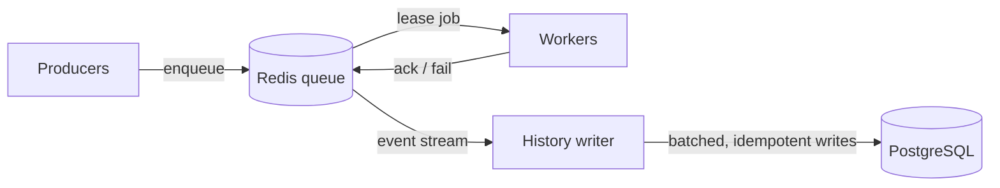

# task-queue

A distributed task queue built from scratch in Python, using Redis for the queue and PostgreSQL for job history. It focuses on reliability: jobs survive worker crashes, failed jobs retry with backoff, and repeatedly failing jobs go to a dead-letter queue. No Celery or RQ; building the queue is the point.

> Status: Phase 2 complete (core queue, PostgreSQL history, Docker Compose, live dashboard). Next: load testing and failure-injection benchmarks.

## Architecture



- **Producers** submit jobs.
- **Redis** holds pending jobs.
- **Workers** lease jobs, run them, and report results.
- **PostgreSQL** stores job history: a `jobs` table with each job's current state, and a `job_attempts` table with one permanent row per attempt.
- **History writer** copies events from Redis into PostgreSQL. Each job change and its history event are written in the same atomic Redis step (the outbox pattern), so history can't miss a change, and a PostgreSQL outage never slows the workers.

## Features

- **Leases**: a worker that takes a job holds it for a fixed time. If the worker doesn't ack (confirm it finished) before the lease expires, a reaper puts the job back in the queue.
- **Heartbeats**: a worker running a long job extends its lease every few seconds. If the worker dies, the heartbeats stop and the lease expires.
- **Lease tokens**: each lease gets a unique token, so a slow worker whose lease already expired can't mark a job done that another worker now owns.
- **Delayed jobs**: a job can be scheduled to become ready later.
- **Atomic moves**: every state change runs as a Redis Lua script, so jobs can't be lost between steps.

- **Retries with backoff and jitter**: a failed job waits a random time between 0 and `base × 2^(attempts−1)` (capped) before retrying, so jobs that fail together don't retry together.
- **Dead-letter queue**: after `max_attempts` failures, including worker crashes, a job moves to a dead-letter set so poison jobs can't loop forever.
- **Dead-letter replay**: after fixing the cause of an outage, replay one dead job or every job whose error matches. Bulk replay runs in small batches so Redis never stalls the workers.
- **Durable job history**: every attempt is recorded in PostgreSQL, including attempts before a replay. Writes are idempotent, so a crashed history writer can safely re-apply events. A malformed event is retried 3 times, then set aside in a `dead_events` table so it can't block history.

Planned: idempotency, priority.

## Getting started

Requires [Docker Desktop](https://www.docker.com/products/docker-desktop/).

```bash
git clone https://github.com/calliec-1223/task-queue.git && cd task-queue
cp .env.example .env              # then set POSTGRES_PASSWORD to any strong value
docker compose up -d --build      # Redis, PostgreSQL, 3 workers, history writer, dashboard
```

Open the dashboard at http://localhost:8000.

- `docker compose up -d --scale worker=10` runs 10 workers instead of 3.
- `docker compose logs -f worker` follows the worker logs.
- `docker compose down` stops everything. Data is kept in Docker volumes, so jobs and history survive restarts.

To submit jobs or run tests from your own machine, also set up Python:

```bash
python3 -m venv .venv && source .venv/bin/activate
pip install -r requirements-dev.txt
```

## Usage

With Docker Compose running, workers and the history writer are already up. To run them directly on your machine instead (e.g. while developing):

```bash
python -m src.worker
python -m src.history
```

Submit jobs:

```bash
python -m src.enqueue echo '{"msg": "hello"}'          # runs right away
python -m src.enqueue sleep '{"seconds": 5}' --delay 10  # ready in 10 seconds
python -m src.enqueue fail --max-attempts 3             # always fails: retries, then dead-letters
```

Watch it live at http://localhost:8000. It shows where jobs are right now (ready, waiting, running, done, dead), jobs completed and attempts failed per second over the last minute, and recent jobs with their status and errors. Raw numbers are at http://localhost:8000/metrics as JSON.

Started by Docker Compose, or directly with `python -m src.metrics`.

Inspect and replay the dead-letter queue:

```bash
python -m src.dlq list
python -m src.dlq replay <job_id>
python -m src.dlq replay-all --error "connection refused"
```

Each worker leases a job, sends heartbeats from a background thread while the job runs, then acks or fails it. Every worker also reaps expired leases, which is safe because reaping is one atomic Lua script. Ctrl-C finishes the current job before exiting.

Settings (environment variables): `REDIS_URL`, `QUEUE_NAME`, `LEASE_SECONDS`.

## Design decisions

See [DECISIONS.md](DECISIONS.md).

## Testing

```bash
pytest
```

Tests need Redis and PostgreSQL running (`docker compose up -d redis postgres`). They use Redis database 15 and wipe it, so they never touch real data. The failure tests include a real worker process killed with `SIGKILL` mid-job, a poison job that crashes every worker, and stale workers trying to ack, fail or heartbeat after losing their lease.
