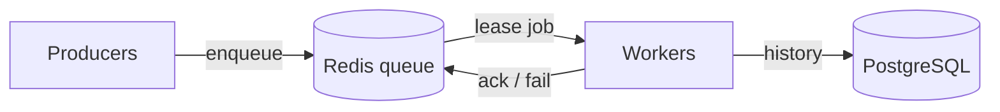

# task-queue

A distributed task queue built from scratch in Python, using Redis for the queue and PostgreSQL for job history. It focuses on reliability: jobs survive worker crashes, failed jobs retry with backoff, and repeatedly failing jobs go to a dead-letter queue. No Celery or RQ; building the queue is the point.

> Status: Phase 1 (core queue) in progress.

## Architecture



- **Producers** submit jobs.
- **Redis** holds pending jobs.
- **Workers** lease jobs, run them, and report results.
- **PostgreSQL** stores job history (planned, Phase 2).

## Features

- **Leases**: a worker that takes a job holds it for a fixed time. If the worker doesn't ack (confirm it finished) before the lease expires, a reaper puts the job back in the queue.
- **Heartbeats**: a worker running a long job extends its lease every few seconds. If the worker dies, the heartbeats stop and the lease expires.
- **Lease tokens**: each lease gets a unique token, so a slow worker whose lease already expired can't mark a job done that another worker now owns.
- **Delayed jobs**: a job can be scheduled to become ready later.
- **Atomic moves**: every state change runs as a Redis Lua script, so jobs can't be lost between steps.

- **Retries with backoff and jitter**: a failed job waits a random time between 0 and `base × 2^(attempts−1)` (capped) before retrying, so jobs that fail together don't retry together.
- **Dead-letter queue**: after `max_attempts` failures, including worker crashes, a job moves to a dead-letter set so poison jobs can't loop forever.

Planned: idempotency, priority.

## Getting started

```bash
git clone <repo-url> && cd task-queue
cp .env.example .env              # then fill in values
python3 -m venv .venv && source .venv/bin/activate
pip install -r requirements.txt
docker run -d --name tq-redis -p 6379:6379 redis:7.4   # first time; afterwards: docker start tq-redis
```

## Usage

Start a worker (run several in separate terminals to scale out):

```bash
python -m src.worker
```

Submit jobs:

```bash
python -m src.enqueue echo '{"msg": "hello"}'          # runs right away
python -m src.enqueue sleep '{"seconds": 5}' --delay 10  # ready in 10 seconds
python -m src.enqueue fail --max-attempts 3             # always fails: retries, then dead-letters
```

Each worker leases a job, sends heartbeats from a background thread while the job runs, then acks or fails it. Every worker also reaps expired leases, which is safe because reaping is one atomic Lua script. Ctrl-C finishes the current job before exiting.

Settings (environment variables): `REDIS_URL`, `QUEUE_NAME`, `LEASE_SECONDS`.

## Design decisions

See [DECISIONS.md](DECISIONS.md).

## Testing

```bash
pytest
```

Tests need Redis running. They use Redis database 15 and wipe it, so they never touch real data. The failure tests include a real worker process killed with `SIGKILL` mid-job, a poison job that crashes every worker, and stale workers trying to ack, fail or heartbeat after losing their lease.
