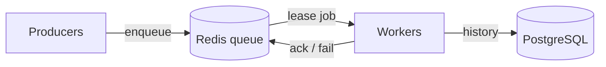

# task-queue

A distributed task queue built from scratch in Python, using Redis for the queue and PostgreSQL for job history. It focuses on reliability: jobs survive worker crashes, failed jobs retry with backoff, and repeatedly failing jobs go to a dead-letter queue. No Celery or RQ; building the queue is the point.

> Status: Phase 1 (core queue) in progress.

## Architecture



- **Producers** submit jobs.
- **Redis** holds pending jobs.
- **Workers** lease jobs, run them, and report results.
- **PostgreSQL** stores job history (planned, Phase 2).

## Features

- **Leases**: a worker that takes a job holds it for a fixed time. If the worker doesn't ack (confirm it finished) before the lease expires, a reaper puts the job back in the queue.
- **Lease tokens**: each lease gets a unique token, so a slow worker whose lease already expired can't mark a job done that another worker now owns.
- **Delayed jobs**: a job can be scheduled to become ready later.
- **Atomic moves**: every state change runs as a Redis Lua script, so jobs can't be lost between steps.

Planned: retries with exponential backoff, dead-letter queue, idempotency, priority.

## Getting started

```bash
git clone <repo-url> && cd task-queue
cp .env.example .env              # then fill in values
python3 -m venv .venv && source .venv/bin/activate
pip install -r requirements.txt
docker run -d --name tq-redis -p 6379:6379 redis:7.4
```

## Design decisions

See [DECISIONS.md](DECISIONS.md).

## Testing

```bash
pytest
```
