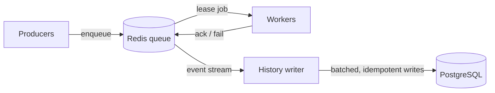

# task-queue

[](https://github.com/calliec-1223/task-queue/actions/workflows/tests.yml)

A distributed task queue built from scratch in Python, using Redis for the queue and PostgreSQL for job history. It focuses on reliability: jobs survive worker crashes, failed jobs retry with backoff, and repeatedly failing jobs go to a dead-letter queue. No Celery or RQ; building the queue is the point.

> Status: all six reliability features are built (leases, retries with backoff, dead-letter queue, idempotency, delayed and priority jobs, benchmarks and failure tests), plus PostgreSQL history and a real integration with my recipe app.

## Architecture



- **Producers** submit jobs.
- **Redis** holds pending jobs.
- **Workers** lease jobs, run them, and report results.
- **PostgreSQL** stores job history: a `jobs` table with each job's current state, and a `job_attempts` table with one permanent row per attempt.
- **History writer** copies events from Redis into PostgreSQL. Each job change and its history event are written in the same atomic Redis step (the outbox pattern), so history can't miss a change, and a PostgreSQL outage never slows the workers.

## Features

- **Leases**: a worker that takes a job holds it for a fixed time. If the worker doesn't ack (confirm it finished) before the lease expires, a reaper puts the job back in the queue.
- **Heartbeats**: a worker running a long job extends its lease every few seconds. If the worker dies, the heartbeats stop and the lease expires.
- **Lease tokens**: each lease gets a unique token, so a slow worker whose lease already expired can't mark a job done that another worker now owns.
- **Delayed jobs**: a job can be scheduled to become ready later.
- **Atomic moves**: every state change runs as a Redis Lua script, so jobs can't be lost between steps.

- **Retries with backoff and jitter**: a failed job waits a random time between 0 and `base × 2^(attempts−1)` (capped) before retrying, so jobs that fail together don't retry together.
- **Dead-letter queue**: after `max_attempts` failures, including worker crashes, a job moves to a dead-letter set so poison jobs can't loop forever.
- **Discard**: jobs that will never succeed can be removed from the dead-letter queue (one, or every job whose error matches). History records them as `discarded`, so nothing is lost.
- **Dead-letter replay**: after fixing the cause of an outage, replay one dead job or every job whose error matches. Bulk replay runs in small batches so Redis never stalls the workers.
- **Single active history writer**: writers compete for a Redis lock and the holder writes; a fencing token checked in PostgreSQL rejects any batch from a writer that froze and was replaced, so history stays in order even during failover.
- **Durable job history**: every attempt is recorded in PostgreSQL, including attempts before a replay. Writes are idempotent, so a crashed history writer can safely re-apply events. A malformed event is retried 3 times, then set aside in a `dead_events` table so it can't block history.
- **Idempotency keys**: submitting a job with the same key twice returns the original job instead of a duplicate. The check and the create are one atomic script, so even simultaneous submissions create one job.
- **Result checkpoints**: a finished task's result is saved before the ack. If the job is redelivered (the worker crashed or lost its lease before acking), the next worker reuses the result instead of redoing the work.
- **Permanent errors**: errors that can never succeed (bad input, invalid credentials) skip the retries and go straight to the dead-letter queue. A task lists such error types (`Task(fn, no_retry=(...))`) or raises `PermanentError` itself.
- **Graceful shutdown**: on a deploy, a worker lets its current job finish for up to 25 s; if it's still running, the worker hands it back to the queue without using up an attempt and exits before Docker's 30 s stop window ends. Deploys never count against a job's retries.
- **Time limits**: each job has a maximum run time (default 5 minutes). Heartbeats can't extend a lease past it, so a hung task times out and is retried or dead-lettered like any failure. The stuck worker exits and Docker restarts it, since a Python thread can't be killed.
- **Backpressure**: when too many jobs are waiting (default 100,000), enqueue refuses new ones with `QueueFull` instead of letting Redis run out of memory; payloads over 64 KB are refused too. The check is atomic, so simultaneous producers can't overshoot.
- **Cleanup**: Redis only keeps what's live. Finished jobs are removed from Redis after 24 hours and dead-lettered jobs after 30 days, in small batches; PostgreSQL keeps the permanent history.
- **Priority with aging**: higher-priority jobs run first, but each priority level is worth 60 seconds of waiting, so a lower-priority job that has waited long enough catches up and nothing starves. Delayed and retrying jobs wait in a separate set, so priority never lets a job run before its time.

## Getting started

Requires [Docker Desktop](https://www.docker.com/products/docker-desktop/).

```bash
git clone https://github.com/calliec-1223/task-queue.git && cd task-queue
cp .env.example .env              # then set POSTGRES_PASSWORD to any strong value
docker compose up -d --build      # Redis, PostgreSQL, 3 workers, history writer, dashboard
```

Open the dashboard at http://localhost:8000.

- `docker compose up -d --scale worker=10` runs 10 workers instead of 3.
- `docker compose logs -f worker` follows the worker logs.
- `docker compose down` stops everything. Data is kept in Docker volumes, so jobs and history survive restarts.

To submit jobs or run tests from your own machine, also set up Python:

```bash
python3 -m venv .venv && source .venv/bin/activate
pip install -r requirements-dev.txt
```

## Usage

With Docker Compose running, workers and the history writer are already up. To run them directly on your machine instead (e.g. while developing):

```bash
python -m taskqueue.worker
python -m taskqueue.history
```

Submit jobs:

```bash
python -m taskqueue.enqueue echo '{"msg": "hello"}'          # runs right away
python -m taskqueue.enqueue sleep '{"seconds": 5}' --delay 10  # ready in 10 seconds
python -m taskqueue.enqueue fail --max-attempts 3             # always fails: retries, then dead-letters
python -m taskqueue.enqueue echo '{"msg": "urgent"}' --priority 5  # runs ahead of priority-0 jobs
```

Watch it live at http://localhost:8000. It shows where jobs are right now (ready, waiting, running, done, dead), jobs completed and attempts failed per second over the last minute, and recent jobs with their status and errors. Raw numbers are at http://localhost:8000/metrics as JSON.

Started by Docker Compose, or directly with `python -m taskqueue.metrics`.

The dashboard also shows every **worker** (busy with which job, idle, or dead in red after a crash, then removed), and clicking a job shows its **attempt timeline** from history (e.g. "attempt 1: lease expired → attempt 2: done").

**Demo mode** adds buttons to submit sample jobs, crash a random worker, and replay dead jobs. It's off by default and only for local use:

```bash
DEMO_CONTROLS=1 LEASE_SECONDS=6 docker compose up -d --build --scale worker=4
```

A short lease makes a killed worker's job recover in seconds. "Kill a worker" sets a flag in Redis that the chosen worker sees on its next check-in, then exits instantly like a crash (the dashboard never gets access to Docker itself).

Inspect and replay the dead-letter queue:

```bash
python -m taskqueue.dlq list
python -m taskqueue.dlq replay <job_id>
python -m taskqueue.dlq replay-all --error "connection refused"
python -m taskqueue.dlq discard-all --error "this task always fails"   # give up for good
```

Each worker leases a job, sends heartbeats from a background thread while the job runs, then acks or fails it. Every worker also reaps expired leases, which is safe because reaping is one atomic Lua script. Ctrl-C finishes the current job before exiting.

Settings (environment variables): `REDIS_URL`, `QUEUE_NAME`, `LEASE_SECONDS`.

## Benchmarks

All numbers below come from real runs ([raw results](bench/results/)) of the current code on an Apple M2 MacBook (8 cores), with every service running in Docker Compose. Workers run 20 ms jobs (`sleep`), standing in for I/O-bound work like an API call.

### Throughput scales almost linearly with workers


| Workers | Jobs/sec | Ideal | Efficiency |
|---|---|---|---|
| 1 | 38 | 50 | 76% |
| 2 | 81 | 100 | 81% |
| 4 | 176 | 200 | 88% |
| 8 | 331 | 400 | 83% |
| 16 | 667 | 800 | 83% |

"Ideal" is workers ÷ 20 ms, assuming zero queue overhead. Efficiency stays around 80% from 1 to 16 workers, so the queue itself isn't the bottleneck at this scale. The gap is most likely fixed per-job overhead in the worker (several Redis round trips per job: lease, read the job, checkpoint, ack; plus starting a heartbeat thread), not yet profiled.

### Latency: a doorbell instead of polling


Jobs arrive at a steady 100/sec for 20 seconds. Latency is enqueue → done, timed by the Redis clock on both ends. Cells show p50 / p99.

| Workers | Poll every 500 ms | Poll every 50 ms | Adaptive polling | Doorbell (default) |
|---|---|---|---|---|
| 1 | 12,860 / 28,620 ms | 12,266 / 27,215 ms | 12,611 / 27,428 ms | 12,830 / 30,093 ms |
| 2 | 1,401 / 2,545 ms | 851 / 1,785 ms | 1,272 / 2,457 ms | 994 / 2,078 ms |
| 4 | 48 / 226 ms | 26 / 34 ms | 26 / 274 ms | 21 / 23 ms |
| 8 | 42 / 199 ms | 25 / 33 ms | 25 / 105 ms | 21 / 24 ms |
| 16 | 36 / 176 ms | 24 / 31 ms | 24 / 34 ms | 21 / 23 ms |

Sorted sets have no "wait until a job arrives" command ([DECISIONS.md](DECISIONS.md) #2), so workers originally polled. Now, whenever a job becomes ready, the same Lua script also pushes a token onto a **doorbell** list, and idle workers block on `BLPOP` until one arrives (or the next delayed job is due). One token wakes one worker, so there's no thundering herd, and each job's token is used exactly once, so tokens can't go stale. The sorted sets stay the source of truth; the doorbell only says "check now."

Measured with 16 idle workers:

| Wait mode | Redis commands/sec (idle) |
|---|---|
| Poll every 500 ms | 337 |
| Poll every 50 ms | 1,667 |
| Adaptive polling | 338 |
| **Doorbell** | **293** |

The doorbell has the best median and the best, most consistent p99 (about 23 ms at 4, 8 and 16 workers), with the lowest idle load. What remains is each worker's once-a-second check-in, reaping and cleanup, not polling. Counts include the commands each Lua script runs inside Redis.

- 1–2 workers can't keep up with 100 jobs/sec, so the backlog grows and latency is measured in seconds in every mode.
- p99 varies between runs, so compare modes within the same run.

### Zero job loss while workers are killed

`python -m bench.chaos` submits 1,000 jobs while repeatedly `SIGKILL`ing random worker containers and the history writer (no chance to clean up), restarting them a second later.

| Jobs submitted | Completed | Lost | Worker kills | History writer kills | Jobs interrupted mid-run | Recorded done twice |
|---|---|---|---|---|---|---|
| 1,000 | 1,000 | **0** | 20 | 5 | 13 | 0 |

Interrupted jobs were recovered by lease expiry and finished on a later attempt. Some kills hit idle workers, which is why there are fewer interrupted jobs than kills. Every job appears exactly once in PostgreSQL history, despite the history writer being killed 5 times.

Reproduce: `docker compose up -d --build`, then `python -m bench.benchmark`, `python -m bench.idle_load`, `python -m bench.chaos`, and `python -m bench.plot`.

## Real-world use: Whisk's AI baking assistant

[Whisk](https://github.com/calliec-1223/whisk) is my recipe app. Its chat assistant called the Claude API inside the web request, so a server process sat idle for the whole answer (2-3 seconds) and couldn't serve anyone else. Whisk now uses this queue as a library: `POST /chat` enqueues the question and returns `202 Accepted` with a job ID in milliseconds; a Whisk worker asks Claude; the browser checks `GET /chat/<id>` once a second. Only the user who asked can read the answer. ([DECISIONS.md](DECISIONS.md) #14-16)


Load test: Whisk on gunicorn with 2 server processes. Some users chat back to back while another loads their recipe list 5 times a second. Claude is replaced by a stand-in that replays 20 measured real response times (median 2.416 s), so the test is free and repeatable. Medians:

| People chatting | Page load, before | Page load, after | `POST /chat`, before | `POST /chat`, after | Answer, before | Answer, after |
|---|---|---|---|---|---|---|
| 1 | 7 ms | 6 ms | 2,437 ms | 5 ms | 2.4 s | 3.1 s |
| 4 | 3,375 ms | 7 ms | 4,935 ms | 17 ms | 4.9 s | 3.1 s |
| 8 | 9,255 ms | 8 ms | 9,959 ms | 21 ms | 10.0 s | 5.2 s |

- **Page loads stay fast.** Before, every chat held one of the 2 server processes for the whole Claude call, so recipe pages waited behind chats. After, the server only enqueues and reads results.
- **Answers are faster under load, slower when idle.** With 1 user, the queue adds about 0.7 s (the browser checks once a second, plus the history writer's lag). With 4-8 users, answers arrive sooner, partly because queue mode runs 4 workers in addition to the 2 server processes, so it isn't an equal-resources comparison for answer time. The page-load result doesn't depend on that: it comes from the web server no longer waiting on Claude.
- **Retries for free.** A failed Claude call is retried with backoff, then dead-lettered, instead of the user getting an error.

[Raw results](bench/results/). Reproduce from Whisk's `backend/`: `python -m bench.measure_claude` (real calls, costs a few cents) and `python -m bench.load_test`.

## Known limitations

These are deliberate tradeoffs or not-yet-built pieces, not bugs:

- **Redis is a single point of failure.** There's no replica or failover. Redis saves every write to disk once per second, so a restart keeps the queue, but if the whole machine crashes, up to about 1 second of changes can be lost (jobs and their history events are lost together, so they never disagree).
- **One active history writer per queue.** Events for a job must be applied in order, so only one writer writes at a time (others wait on standby and take over within about 10 s; a fencing token stops a frozen writer from writing late). That caps how fast history can be written; if the writer falls behind, events wait in Redis memory. History writer throughput hasn't been benchmarked yet.
- **Single Redis server only.** The Lua scripts build some key names inside the script, which Redis Cluster doesn't allow, so scaling past one Redis server would mean redesigning the key layout.
- **At-least-once, not exactly-once.** If a worker freezes long enough to lose its lease but is still alive, another worker can run the same job at the same time. Result checkpoints keep the recorded result consistent, but both runs do the work.

## Design decisions

See [DECISIONS.md](DECISIONS.md).

## Testing

```bash
pytest
```

Tests need Redis and PostgreSQL running (`docker compose up -d redis postgres`). They use Redis database 15 and wipe it, so they never touch real data. The failure tests include a real worker process killed with `SIGKILL` mid-job, a poison job that crashes every worker, and stale workers trying to ack, fail or heartbeat after losing their lease.
